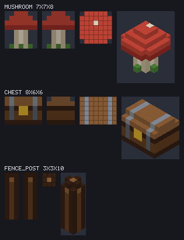

# meshbox

[](https://crates.io/crates/meshbox)
[](https://docs.rs/meshbox)
[](https://github.com/jmsansan/meshbox/actions/workflows/ci.yml)
[](#install)
[](LICENSE)

**Low-poly and voxel 3D models from plain text, in safe Rust.** Write a model as
stacked grids of palette keys, and meshbox meshes it, exports binary glTF (`.glb`)
that engines and Blender open, and renders a preview sheet from four views.

meshbox is to 3D what [spritebox](https://github.com/jmsansan/spritebox) is to pixel
art, and it is designed first for **AI-assisted authoring**: an assistant cannot model
with a mouse, but it can write precise text, render it, look at the preview and
correct the text. Every diagnostic has a line, a column and a stable code, and the
same text gives the same bytes on every platform.

**meshbox has zero dependencies.** It uses nothing but the Rust standard library: it
has its own PNG encoder, JSON and glTF writers, and software rasterizer, and it builds
for `wasm32-unknown-unknown`.



The [showcase](examples/showcase.meshbox): three props for a small forest game
sharing one palette, as `meshbox render` draws them.

## Capabilities

| Capability | Status |
| --- | --- |
| Text format with exact diagnostics (line, column, stable code) | Available |
| Palettes with spritebox's syntax, shared palette texture | Available |
| Voxel models from stacked grids | Available |
| Greedy meshing to a deterministic mesh | Available |
| Binary glTF (`.glb`) export | Available |
| Four-view preview sheet (PNG) | Available |
| Imports through a loader, in memory and in WebAssembly | Available |
| Command-line tool: `check` and `render` | Available |
| Low-poly primitives, composition and modifiers | Planned (0.2) |
| Heightmap terrain | Planned (0.3) |
| Seeded generators and scattering | Planned (0.4) |
| Rigid animation with pivots and clips | Planned (0.5) |
| Materials and game-ready vertex data | Planned (0.6) |

## Install

```text
cargo add meshbox             # the library
cargo install meshbox         # the `meshbox` command
```

meshbox needs Rust 1.85 or later.

## Example

```rust
use meshbox::{Document, PreviewOptions};

let text = "\
palette crate
  w #94643a
  k #3b2417

voxels box 2x2x2 palette=crate
  level 0
    kk
    kk
  level 1
    ww
    ww
";
let document = Document::parse(text)?;
let glb = document.glb("box")?;
assert_eq!(&glb[..4], b"glTF");
let preview = document.preview(&PreviewOptions::default())?;
assert!(preview.width() > 0);
# Ok::<(), meshbox::Error>(())
```

## The text format

A file is a list of definitions. Each starts at the first column with a directive and
a name; the lines under it are indented with spaces, the same amount for the whole
block, and nested blocks indent further. Tabs in indentation are an error. `;` starts
a comment to the end of the line, and blank lines are ignored. Names use ASCII
letters, digits, `_` and `-`, at most 128 characters.

Options are `key=value` after the name. Numbers are decimal; sizes are `WxDxH` for
models; vectors are `x,y,z`.

### Palettes

```meshbox
palette forest
  .  transparent
  t  #8b5a2b   ; trunk
  l  #4f8a3a
  g  #a0d8ff80 ; glass: #rrggbbaa is translucent

palette autumn from=forest
  l  #c8782a
```

A palette maps one-character keys to `#rrggbb`, `#rrggbbaa` or `transparent`.
`from=` copies another palette's keys, then replaces or adds its own. The syntax is
exactly spritebox's, `ramp` lines and `lint=` included, so **a file holding only
palettes is valid in both crates**, and a game's 2D and 3D art can share one palette
file. meshbox reads nothing else of spritebox's: a `sprite` in a meshbox file is an
error that names it.

`.` is empty space in a model whatever the palette says, and so is a fully
transparent key.

### Voxel models

```meshbox
palette p
  t #8b5a2b
  r #c0392b
  w #f4f4f4

voxels mushroom 5x4x3 palette=p origin=2.5,0,2 unit=1/16
  level 0
    .....
    ..t..
    .....
    .....
  level 2
    rrrrr
    rwrrr
    rrrrr
    rrrrw
```

`voxels NAME WxDxH palette=P` is a box `W` voxels wide (along +X), `D` deep (along
+Z) and `H` high (along +Y). Each `level N` block is one horizontal slice, from the
ground (`level 0`) up. Its rows run from the back (-Z, the top of the text, as north
on a map) to the front (+Z), and its columns from -X to +X: this is what the
preview's top view shows, so text and picture match. A missing level is empty.

- `origin=x,y,z` is the model's pivot in voxels, from the corner at the back, left
  and bottom (default: the center of the bottom face, the model's feet). Each
  coordinate is within ±65536.
- `unit=` is the side of a voxel in meters, as a decimal or a fraction (default
  `1/16`, the 16-pixels-per-meter scale of Diamon's sprites).

Coordinates follow glTF: right-handed, +Y up, meters.

### Imports

```text
import palettes.meshbox
import "art/props.meshbox"
```

`import NAME` brings in another file's definitions; the name may be quoted. Names
resolve against the importing file's directory, and the caller's loader reads them
(see below), so nothing touches the file system unless the loader does. Imports in a
cycle are an error, and so are imports nested deeper than `max_nesting`.

## Output

- **Meshes.** `Document::mesh` gives a `Mesh`: positions, normals and UVs as `f32`,
  `u32` indices, counter-clockwise front faces, opaque triangles first and
  translucent ones from `translucent_start`. Faces between solid voxels are dropped,
  and faces of one key and direction in a plane are merged into rectangles by greedy
  meshing, in a fixed order, so the same text gives the same bytes.
- **The palette texture.** Every palette of a document in one RGBA8 image, one row
  per palette and one texel per key; each key's UV is its texel's center. Every model
  of a document samples this one texture, so a renderer can draw them all with one
  material.
- **Binary glTF.** `Document::glb(name)`, or `Document::export()` and
  `Export::glb_files()` for every model. One scene, one node per model at its origin,
  the palette texture embedded as PNG with nearest filtering and clamped edges, an
  opaque material, and a blended one for translucent keys. The showcase's files pass
  the Khronos glTF Validator with no errors or warnings, and Diamon's `gltf` feature
  imports them.
- **Preview sheets.** `Document::preview` draws each model from the front, the right,
  the top and a 3/4 view from the front right, with its name and size above, using a
  fixed-point software rasterizer: the same pixels on every platform.

## Writing models with an assistant

The loop is: write the text, run `meshbox render`, look at `preview.png`, correct the
text.

- **Read the four views** left to right: the front (looking toward -Z), the right
  side (looking toward -X), the top (looking down, the back at the top, exactly as
  each `level` block is written) and a 3/4 view from the front right. The top view's
  grid lines mark voxel boundaries, so a voxel's column and row can be counted.
- **Use `meshbox check --json`** for diagnostics: each has a stable `code`, a `line`
  and a `column`.
- **Keep to a scale.** At the default `unit=1/16`, sixteen voxels are a meter; a
  character is 24 to 32 voxels tall, a door about 32.
- **Put pivots at the feet.** The default origin is the center of the bottom face,
  which is where most engines place and rotate props.
- **Shade with keys.** Faces are flat colors; a lighter key on top layers and a darker
  one at the base read better than one color throughout.

## From memory, and in WebAssembly

```rust
use meshbox::{Document, Error, ErrorCode, Limits};

let mut loader = |name: &str| match name {
    "palettes.meshbox" => Ok("palette p\n  a #ffffff\n".to_owned()),
    _ => Err(Error::new(ErrorCode::Io, format!("no file {name}"))),
};
let text = "import palettes.meshbox\nvoxels dot 1x1x1 palette=p\n  level 0\n    a\n";
let document = Document::parse_with_loader(text, &Limits::default(), &mut loader)?;
assert!(document.model("dot").is_some());
# Ok::<(), Error>(())
```

The library never touches the file system: imports go through the loader, and every
output is returned in memory. [`examples/embedded.rs`](examples/embedded.rs) builds
glb files from text compiled into the program and builds for
`wasm32-unknown-unknown`.

## Command-line tool

```text
meshbox check <file> [--json]
meshbox render <file> --out <dir> [--scale <n>] [--model <name>] [--json]
```

- `check` prints each diagnostic as `file:line:column: error[code]: message` on
  standard error, or one JSON object on standard output with `--json`: `version`,
  `file`, `ok`, `diagnostics` (each with `code`, `severity`, `line`, `column`,
  `message`, and `file` for an imported file) and `written`.
- `render` writes `model-NAME.glb` for each model (or only `--model`), `palette.png`,
  `preview.png` and `meshbox.json`, which lists each model's file, size, origin, unit,
  bounds and triangle and vertex counts. Nothing is written when the file has errors.
  `--scale` is the preview's pixels per voxel, 1 to 32 (default 8).
- `<file>` may be `-` for standard input. Imports are read relative to the file.
- Exit statuses: 0 success, 1 the file has errors, 2 bad usage, 3 an I/O error.

## Errors

`Document::parse` returns the first error; `meshbox::check` returns every error, up
to 1000, ordered by position. Each `Error` has a stable `code`, a `message`, a
1-based `position` (line, and column counted in characters) and, for an error in an
imported file, that file's name. The codes and their JSON names:

| Code | JSON | Meaning |
| --- | --- | --- |
| `Syntax` | `syntax` | Malformed text: an unknown directive, a missing value, bad indentation |
| `InvalidArgument` | `invalid_argument` | A value of the right shape but out of range |
| `UnknownName` | `unknown_name` | A palette, model or key that is not defined |
| `DuplicateName` | `duplicate_name` | A second definition of a name |
| `SizeMismatch` | `size_mismatch` | A grid whose rows or columns do not match the size |
| `Cycle` | `cycle` | Palettes or imports that refer to each other in a circle |
| `LimitExceeded` | `limit_exceeded` | Input or output beyond the `Limits` |
| `EncodeError` | `encode_error` | Output that cannot be encoded |
| `Io` | `io` | A file could not be read or written |

## Limits

`Limits` bounds the work any input can cause. Every parsing function takes one;
the defaults suit hand-written files and untrusted input. Parsing takes memory in
proportion to the text, which `max_text_bytes` bounds, and keeps the first 1000
errors by position.

| Limit | Default | Bounds |
| --- | --- | --- |
| `max_text_bytes` | 4194304 | Bytes of text, imported files included |
| `max_definitions` | 4096 | Top-level definitions |
| `max_palette_colors` | 256 | Keys in one palette |
| `max_voxel_side` | 256 | Width, depth or height of one voxel model |
| `max_voxels` | 16777216 | Voxels of all models together |
| `max_triangles` | 1048576 | Triangles in one model's mesh |
| `max_vertices` | 4194304 | Vertices of all meshes together |
| `max_image_side` | 8192 | Side of any image created |
| `max_image_pixels` | 16777216 | Pixels of any image created |
| `max_nesting` | 32 | Depth of `from=` chains and imports |

## Limitations

- 0.1 reads voxel models only; primitives, terrain, generators, animation and
  materials are planned (see the table above).
- Faces are flat colors from the palette texture; there are no smooth normals,
  ambient occlusion or per-key materials yet.
- Greedy meshing is fast, not minimal, and leaves T-junctions where large and small
  rectangles meet; every corner is exact, so there are no cracks.
- Previews are orthographic, with one fixed light.

## License

MIT
